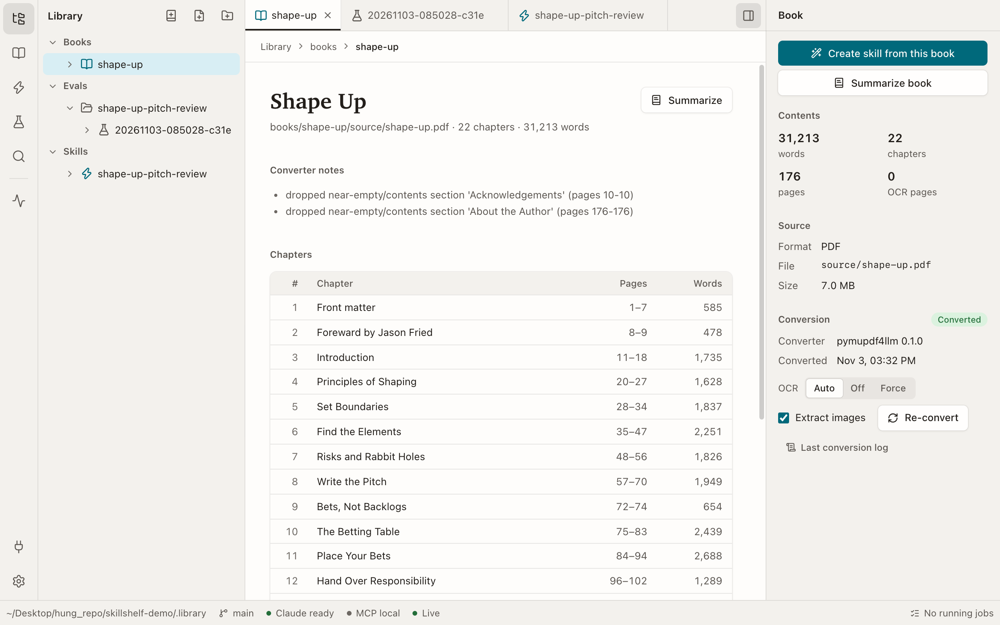

# Skillshelf

Turn a PDF or EPUB book into a Claude **Agent Skill** built for a goal you name (for example "audit a SaaS onboarding flow"). Preview and edit everything in a local web UI, measure the skill with evals (with-skill vs no-skill), and use it from Claude Code, Claude.ai or ChatGPT over MCP.



```
book.pdf/.epub ──convert──▶ chapter Markdown ──generate (Claude Code)──▶ skills/<name>/
                                                                           SKILL.md
                                                                           references/*.md
                                                                           evals/evals.json
        ┌───────────────────────── eval: with_skill vs baseline, graded per expectation
        ├───────────────────────── install: symlink into ~/.claude/skills  ·  export .zip for claude.ai
        └───────────────────────── MCP: stdio (Claude Code) · HTTP + tunnel (Claude.ai, ChatGPT)
```

## Requirements

- Node **22.12+** (`.nvmrc` pins 22.22.1; Vite 8 does not run on older 22.x), pnpm 10
- [uv](https://docs.astral.sh/uv/) (the converter pins Python 3.12 itself)
- [Claude Code](https://code.claude.com) logged in with your **claude.ai** account (`claude auth status` → `"authMethod": "claude.ai"`)
- Optional: `tesseract` (OCR for scanned pages), `cloudflared` or `ngrok` (public MCP URL)

## Setup and run

```bash
nvm use                 # Node 22.22.1
pnpm bootstrap          # pnpm install + uv sync of the converter
pnpm dev                # API on :4317 (+ MCP-only :4318), UI on http://127.0.0.1:5317
```

`pnpm dev` restarts the server whenever server code changes, and a restart cancels running jobs. For long generation/eval runs use `pnpm dev:server` (no watch) together with `pnpm dev:web`, or `pnpm start` (builds the UI and serves everything on :4317).

## Using it

1. **Import** a PDF/EPUB (button or drag-drop onto the tree). The converter splits it into chapters using the book's table of contents (`library/books/<slug>/markdown/`) and writes `book.json`.
1b. **Summarize** (book view or inspector): pick length (brief, standard, detailed), structure (by chapter, key ideas, both), an optional focus ("I'm a PM improving onboarding" adds High/Medium/Low relevance per chapter and a reading path) and the chapters. The summary is written to `library/books/<slug>/summaries/` and every chapter heading links to its chapter file; relative links in any Markdown preview open in-app as tabs (middle-click or ⌘-click opens a background tab).
2. **Create skill** from the book view: describe the goal, pick chapters (skip boilerplate like "Praise"), choose a model and an effort level (Low to Max; every Claude job has one, defaults: High for generate/revise, Medium for summaries and eval runs, and the eval judge is always Low). A headless Claude Code session reads the chapters and writes the skill. Watch progress in the Jobs drawer.
3. **Review** the skill view: lint (Agent Skills spec), SKILL.md preview/edit, references, eval cases.
4. **Run evals**: each case runs once with the skill installed and once without, then a judge grades each expectation with evidence. The run view leads with how many cases the skill's answers beat the no-skill answers and how many checks passed with and without it, lists every check the skill still misses (with a button to revise from them), then shows each case's answers and evidence, and whether the skill was used only when it should be.
5. **Revise**: give feedback (optionally "include failures from run X"); a backup is taken first (`.data/skill-backups/`).
6. **Use it**: *Install* symlinks the skill into `~/.claude/skills/` (or a project), *Export* gives a zip to upload as a custom skill on claude.ai, and **Connect** shows MCP setup for every client.

Everything lives in plain files under `library/` (set `LIBRARY_DIR` to use another folder or git repo). The tree shows git status, and edits in the UI save straight to disk. Library contents are gitignored in this repo, so your books, skills and eval runs stay private unless you point `LIBRARY_DIR` at a repo of your own.

### Interface

Left rail: Library, Books, Skills, Evals, Search, Activity (⌃1–⌃6), then Connect and Settings (theme, your Claude account, library path). The account is shown only in the Settings menu, and MCP URLs display the token masked (Copy still copies the real URL), so the app is safe to screen-share. The sidebar follows the rail; opened items become tabs (⌥W closes one, ⌘K / ⌘P quick-opens anything). The right inspector shows the outline, metadata, lint and eval results for the active item; the status bar shows git, Claude login, MCP/tunnel and running jobs.

## Billing and safety

- **No API key is ever used.** Every `claude` child process runs with all `ANTHROPIC_*` / `CLAUDE_CODE_*` variables stripped, and the server refuses to start one unless `claude auth status` reports the claude.ai login. Runs use your subscription. The UI shows the number of runs before an eval starts.
- Generation can only write inside `skills/<name>/` (summaries only inside `books/<slug>/summaries/`), and nothing gets Bash or web access. Eval runs execute in throwaway temp sandboxes.
- The public tunnel reaches a **separate MCP-only listener** (port 4318). The `/api` routes (file edits, token, tunnel control) are local-only and also reject non-local `Host` headers.
- The MCP token sits in the URL path, so treat the URL like a password. Rotate it from the Connect dialog; stop the tunnel when you're done.
- Books are copyrighted: original files and converted chapter text are gitignored; generated skills paraphrase and cite chapters.

## MCP

Tools (all read-only): `list_skills`, `load_skill`, `read_skill_file`, `list_books`, `get_book_outline`, `read_chapter`, `search`, `fetch` (the last two use the shape ChatGPT deep research expects), plus the prompt `use_skill`.

| Client | How |
|---|---|
| Claude Code (this repo) | `.mcp.json` is picked up automatically; approve it once. |
| Claude Code (all projects) | Run the `claude mcp add --scope user skillshelf -- …` command from the Connect dialog. |
| Claude.ai | Start the tunnel in Connect → copy the public URL → Customize → Connectors → Add custom connector → paste → "No sign in". |
| ChatGPT | Same public URL → Plugins/Apps → Add custom MCP server → Authentication: No auth. |

Details and caveats: [docs/mcp-connectors.md](docs/mcp-connectors.md).

## Repo layout

| Path | What |
|---|---|
| `apps/web` | React 19 + Vite UI (rail, sidebars, tabs, inspector, status bar; Markdown preview/edit, book/skill/eval views, jobs, connect) |
| `apps/server` | Hono API, job queue, Claude Code runner, generation, evals, MCP (stdio + HTTP), tunnel |
| `packages/shared` | Types for the library files and the HTTP contract |
| `converter` | Python CLI `book-convert` (pymupdf4llm for PDF, zipfile + markdownify for EPUB) |
| `prompts` | Generation, revision, lint-fix and judge prompts — edit these to change skill style |
| `library` | Your books, skills and eval runs (gitignored) |

## Tests

```bash
pnpm test        # server (vitest, fake claude CLI) + web + converter (pytest)
pnpm typecheck
```

## License

Skillshelf is licensed under the [GNU Affero General Public License v3.0 or later](LICENSE). You may use, modify and share it; if you distribute a modified version or run one as a service for others, you must make its source available under the same license.

The PDF converter depends on PyMuPDF / pymupdf4llm, which are also AGPL-3.0.
